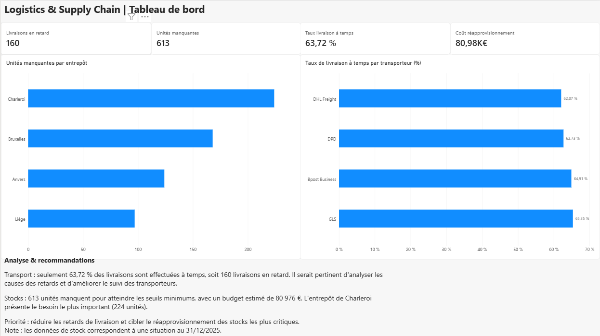

# Portfolio-BI-DATA-karlos
Portfolio de projets Business Intelligence et Data Analytics | Power BI, DAX, Power Query, SQL
# Portfolio Business Intelligence & Data Analytics

Bienvenue sur mon portfolio consacré à la Business Intelligence et à l'analyse de données.

Je développe des projets pratiques pour renforcer mes compétences en Power BI, Power Query, DAX et SQL, avec une attention particulière portée à la compréhension des besoins métier et à la création d'indicateurs d'aide à la décision.

## Projet 1 — Logistics & Supply Chain Analytics

**Objectif :** concevoir un tableau de bord Power BI interactif pour analyser les performances logistiques, les livraisons, les stocks et les fournisseurs.

### Compétences mises en pratique

- Importation et transformation des données avec Power Query
- Modélisation de 7 tables et création de relations
- Création de mesures DAX et d'indicateurs de performance (KPI)
- Conception de 4 pages de tableaux de bord interactifs
- Contrôle de la qualité des données et analyse des résultats

### Principaux résultats

| Indicateur | Résultat |
|---|---|
| Livraisons effectuées à temps | 63,72 % |
| Livraisons en retard | 160 |
| Unités manquantes | 613 |
| Budget de réapprovisionnement estimé | 80 976 € |

### Pages du rapport

1. Vue d'ensemble
2. Transport
3. Stocks
4. Fournisseurs

### Technologies

**Power BI Desktop · Power Query · DAX · Excel**

### À propos des données

Ce projet pédagogique repose sur un jeu de données de démonstration. Les stocks correspondent à une photographie au 31 décembre 2025.

L'objectif est de mettre en pratique les méthodes de Business Intelligence et de présenter une démarche d'analyse reproductible.

---

### Aperçu du tableau de bord

#### 01 — Vue d'ensemble

#### 02 — Transport

#### 03 — Stocks

#### 04 — Fournisseurs

